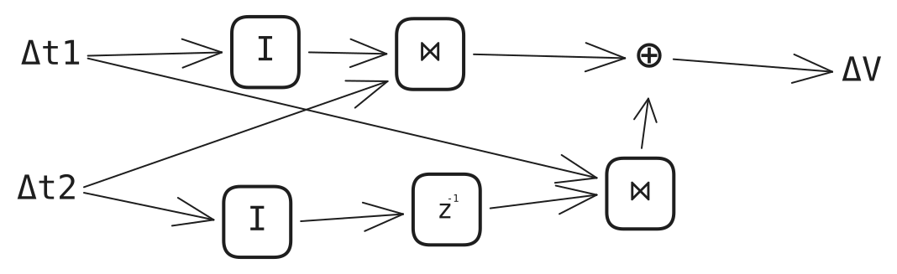

# Контрольная точка 1

- [Описание проекта](../project.md)
- [План эксперимента](../experiment-plan.md)

## Краткий итог

Feldera поднят, pipeline создаётся и управляется из Rust, поток изменений читается. Результат JOIN на пяти обновлениях совпал с ручным расчётом и с двумя собственными движками: полным пересчётом и инкрементальным шагом. Пробный замер времени и памяти не сделан.

## Технические проверки

Проверка выполнена командой `cargo run` в `dbsp/` при запущенном Feldera 0.375.0 на `127.0.0.1:8080`.

Материалы: [адаптер Feldera](../../src/feldera.rs), [полный пересчёт](../../src/naive.rs), [инкрементальный шаг](../../src/incremental.rs), [хранилище](../../src/storage.rs), [драйвер](../../src/main.rs), [запрос](../../sql/01.sql).

Запрос `sql/01.sql`: `t1(id1, x)`, `t2(id2, y)`, `v1 = t1 JOIN t2 ON id1 = id2`.

| Обновление | Ожидалось в v1 | Получено |
|---|---|---|
| insert t1 (1, 2) | пусто | совпало |
| insert t2 (1, 3) | (1,1,2,3) | совпало |
| insert t1 (1, 6) | + (1,1,6,3) | совпало |
| insert t2 (1, 7) | + (1,1,2,7), (1,1,6,7) | совпало |
| delete t1 (1, 2) | остаются (1,1,6,3), (1,1,6,7) | совпало |

Вес каждой строки — 1. Драйвер применяет каждое обновление к трём движкам и сравнивает их `view`; все три совпали на всех пяти обновлениях.

Это проверка авторского артефакта (компоненты собраны, пример связан с заданием, результат сверен с ручным расчётом) и самостоятельной реализации: инкрементальный шаг считает `ΔV = t1' ⋈ Δt2 + Δt1 ⋈ t2`, где `t1'` — таблица после обновления, `t2` — до; описания метода хватило, прототип работает на простом входе с известным результатом.

Пробный замер времени и памяти не выполнен (03.11).

## Ресурсы

Конфигурация приведена в [плане эксперимента](../experiment-plan.md#конфигурации-и-план-запусков). Машина: AMD EPYC 9654, 64 ядра, 244 ГБ ОЗУ, Ubuntu 24.04; Feldera в Docker на ней же. Хватает для локальных серий из плана.

## Трудности

- `http_output()` клиента `feldera-rest-api` непригоден: в OpenAPI ответ `/egress` объявлен одним `Chunk`, метод читает тело до конца соединения, а поток бесконечен. Обход: через `ClientInfo` взять внутренний `reqwest::Client` и базовый URL, читать `bytes_stream()` и разбирать буфер `serde_json::StreamDeserializer`, сохраняя неполный хвост.
- `RuntimeConfig::default()` включает хранилище вопреки комментарию к полю; для состояния в памяти задано `storage: None`.
- `/stop?force=true` асинхронен, статус хранилища становится `InUse` после любого старта. Удаление pipeline: stop и ожидание `Stopped`, clear и ожидание `Cleared`, delete.

## Риски и следующие шаги

- Привести схему и запрос в коде как в [описании проекта](../project.md).
- Написать генератор.
- Выполнить пробный замер времени и памяти; уточнить источник peak memory Feldera.

## Ответственность участников

### Участник: Горохов Дмитрий

- Согласованная ответственность за период: хранилище и движок полного пересчёта.
- Полученный результат и ссылки на материалы: [хранилище](../../src/storage.rs), [полный пересчёт](../../src/naive.rs), типы и `join` в [model.rs](../../src/model.rs), [драйвер](../../src/main.rs), [адаптер Feldera](../../src/feldera.rs).
- Существенное изменение, решение или блокировка: `ZSet` — свой тип, равенство не учитывает нулевые веса; один crate без разделения.
- Следующая ответственность: Реализация движка

### Участник: Понкратов Александр

- Согласованная ответственность за период: подробное изучение статьи и архитектура инкрементального движка и прототип.
- Полученный результат и ссылки на материалы: [инкрементальный шаг](../../src/incremental.rs), схема инкрементального соединения

  
- Существенное изменение, решение или блокировка: не было.
- Следующая ответственность: подготовка тестов (генератор и сбор метрик), архитекрура разбора запросов
